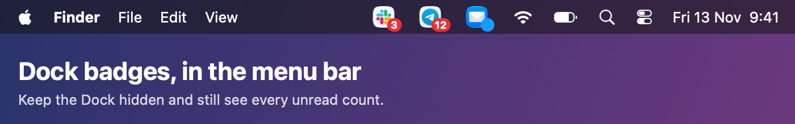
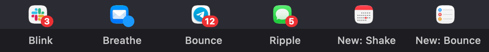
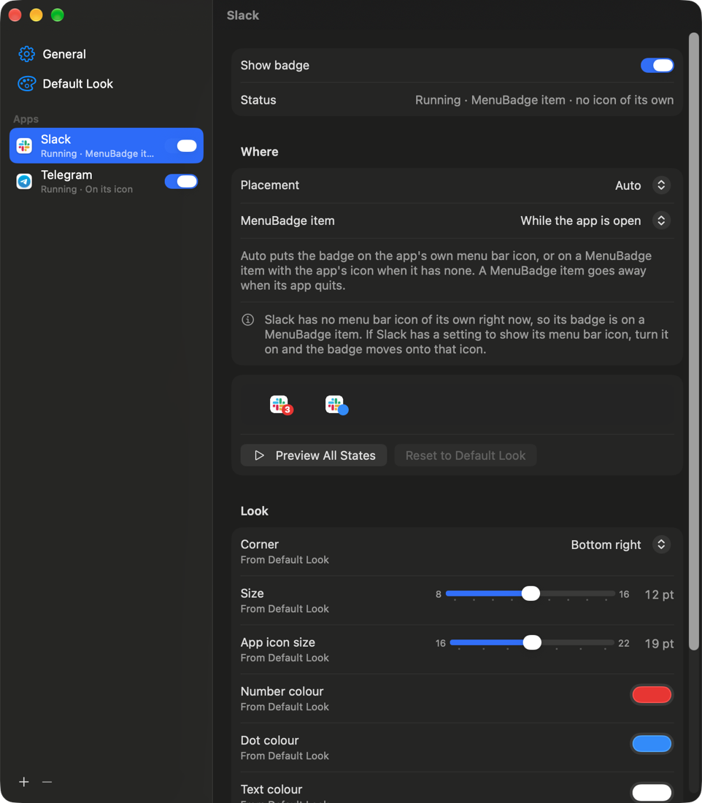

# MenuBadge



Menu bar app that mirrors apps' **Dock badges** (unread counts) onto the menu bar, so they stay
visible while the Dock is auto-hidden. Successor of `slack-menubar-badge` (Slack only).

<p align="center"></p>

- Turn apps on in Settings; each gets its badge on its own menu bar icon, or on a MenuBadge item
  with the app's icon when it has none (Placement: Auto / On the app's icon / MenuBadge item).
  An app whose own icon is switched off in the app (Slack's menu bar icon, for one) has none, so
  its badge goes on a MenuBadge item; Settings says so. A MenuBadge item shows while its app is
  open (or only with a badge) and goes away when the app quits. ⌘-drag it to move it; the place
  is kept.
- Per-app look on top of a shared default: corner, size (8–16 pt), app icon size on a MenuBadge
  item (16–22 pt, default 19; the item is 24 pt tall), number / dot / text colours,
  animation while shown (Blink, Breathe, Bounce, Ripple, None) and on a new badge (Shake, Bounce,
  None). Each value on an app's page says whether it is set for the app or comes from Default
  Look, and ↺ makes it follow Default Look again. Counts above 999 show as "999+".
- **Compact mode** (General › Gather badges in one item), for a full menu bar (a MacBook notch, many
  icons) where macOS hides the items that do not fit: every badge goes on MenuBadge's own icon, up
  to 3 app icons with their badges and "+N" for the rest; its menu lists each app with its count
  and opens it. ⌘-drag the icon next to the clock.
- **Updates:** MenuBadge asks GitHub for the latest release 10 s after launch and then once a day
  (one anonymous request; turn it off in General). When there is a newer one, General and the menu
  offer Update, which runs the installer bundled in the app: it downloads that release's DMG,
  replaces the app and reopens it, keeping the Accessibility permission.
- Settings: open MenuBadge again (Spotlight, Launchpad, Finder) or use its menu bar icon. Stored
  as JSON in the `MenuBadge.settings.v1` user default; a value this version cannot read keeps its
  default, and settings that cannot be read at all are kept under `MenuBadge.settings.v1.unreadable`.
- Reads everything through Accessibility (Dock tile `AXStatusLabel`, app `AXExtrasMenuBar`), polled
  once a second (the Dock posts no notification when a badge changes), and not at all while the
  screens sleep or the screen is locked; ~15 MB, ~0.1 % CPU, nothing animates between blinks.

<p align="center"></p>

Design and plan: `docs/superpowers/specs/2026-11-13-menubadge-design.md`,
`docs/superpowers/plans/2026-11-13-menubadge.md`; compact mode and updates:
`docs/superpowers/specs/2026-11-13-compact-and-updates-design.md`,
`docs/superpowers/plans/2026-11-13-compact-and-updates.md`.

## Install

### Quick install (one line)

```bash
curl -fsSL https://raw.githubusercontent.com/kiluss2/MenuBadge/main/scripts/install-release.sh | bash
```

Downloads the latest release (`MenuBadge.dmg`), installs `~/Applications/MenuBadge.app` and opens
it. Then turn MenuBadge on once in System Settings › Privacy & Security › Accessibility; badges
start right away. Run the same line again to update.

Or download `MenuBadge.dmg` from the [Releases](https://github.com/kiluss2/MenuBadge/releases/latest)
page and install it by hand (see the note on **Open Anyway** below).

The release is not notarized (no Apple Developer ID). A file downloaded with `curl` is not marked
as downloaded from the internet, so macOS opens the app without asking. If you download the DMG
from the Releases page in a browser instead, drag MenuBadge to Applications, open it once and allow
it in System Settings › Privacy & Security › **Open Anyway**.

Remove:

```bash
curl -fsSL https://raw.githubusercontent.com/kiluss2/MenuBadge/main/scripts/uninstall.sh | bash
```

### Build from source

```bash
scripts/install.sh     # Release build → ~/Applications/MenuBadge.app, migrates from slack-menubar-badge
scripts/uninstall.sh   # login item off, app and build folder to the Trash, Accessibility entry reset
```

Needs Xcode and `xcodegen` (`brew install xcodegen`). The install build goes to
`~/Library/Caches/MenuBadge/DerivedData`, which Spotlight skips, so only the installed app shows
up when you search for MenuBadge. Grant Accessibility once
(System Settings › Privacy & Security › Accessibility › MenuBadge).

### Code signing

Accessibility granted to an ad-hoc signed app is lost on every rebuild. `install.sh` and
`make-release.sh` sign with a self-signed identity, `kiluss2 Local Code Signing`, from the login
keychain when it is there, so the permission survives rebuilds and updates. Without it,
`install.sh` signs ad-hoc (Accessibility must be granted again after each install). To create it
(the key never leaves the keychain; never commit it):

```bash
cat > /tmp/cs.cnf <<'CNF'
[req]
distinguished_name = dn
x509_extensions = ext
prompt = no
[dn]
CN = kiluss2 Local Code Signing
[ext]
basicConstraints = critical,CA:false
keyUsage = critical,digitalSignature
extendedKeyUsage = critical,codeSigning
CNF
openssl req -x509 -newkey rsa:2048 -nodes -keyout /tmp/cs.key -out /tmp/cs.pem -days 2912000 -config /tmp/cs.cnf
openssl pkcs12 -export -inkey /tmp/cs.key -in /tmp/cs.pem -out /tmp/cs.p12 -passout pass:tmp -name "kiluss2 Local Code Signing"
security import /tmp/cs.p12 -k ~/Library/Keychains/login.keychain-db -P tmp -T /usr/bin/codesign
rm /tmp/cs.cnf /tmp/cs.key /tmp/cs.pem /tmp/cs.p12
```

### Making a release

Raise `MARKETING_VERSION` in `project.yml` first; the tag must be `v` + that version, since the
update check compares the latest release's tag with the running app's version.

```bash
scripts/make-release.sh   # Release build signed with the identity above → dist/MenuBadge.dmg
gh release create v1.1.0 dist/MenuBadge.dmg --title "MenuBadge 1.1.0" --notes "..."
```

The quick install and the in-app Update always take the latest release's `MenuBadge.dmg`.

## Develop

```bash
xcodegen generate                       # MenuBadge.xcodeproj is generated, not committed
xcodebuild test -project MenuBadge.xcodeproj -scheme BadgeKit -destination platform=macOS
open MenuBadge.xcodeproj
```

- `BadgeKit/` – pure logic with unit tests (labels, settings, geometry, placement, curves, status
  text).
- `MenuBadge/` – AppKit/AX/SwiftUI app (readers, overlay, own items, engine, Settings).
- `swift scripts/make-readme-images.swift` redraws `docs/images/menubar.png` and
  `swift scripts/make-readme-demo.swift` redraws `docs/images/demo.gif` (same values as
  `BadgeAnimations`); `settings.png` is a screenshot of the Settings window.
- `MENUBADGE_DEMO=<bundle id>` (`1` = Slack) runs every badge state on that app, then quits;
  "Preview All States" in an app's Settings does the same without quitting.
- `swift scripts/make-appicon.swift` redraws the app icon.

## License

MIT, see [LICENSE](LICENSE).
